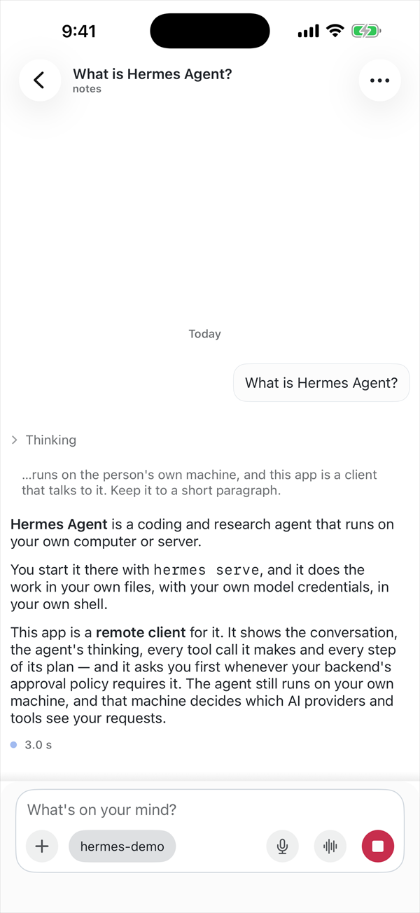
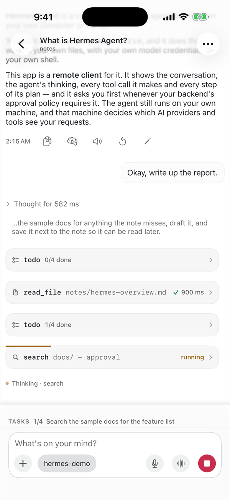
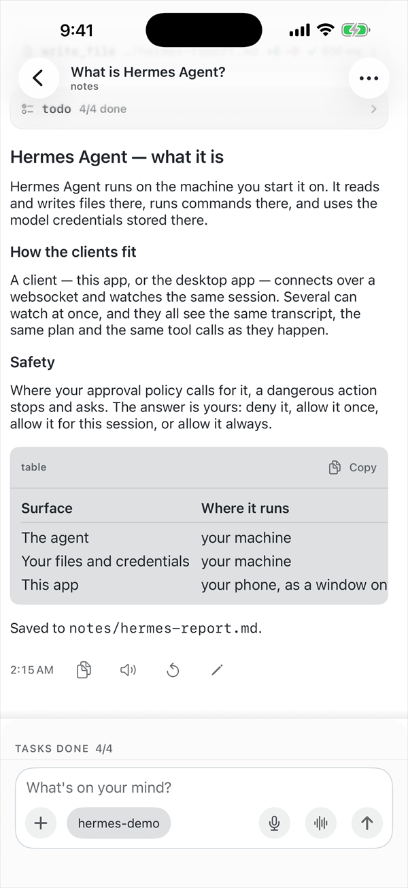
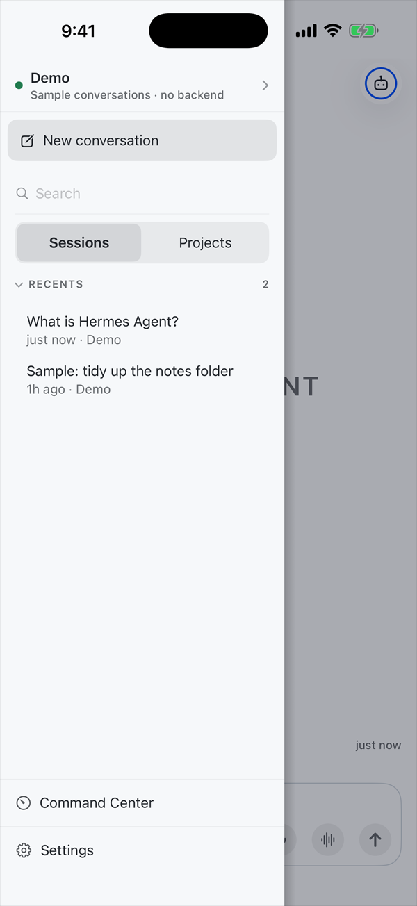

<p align="center"></p>

# HARC

HARC (Hermes Agent Remote Control) is a native iOS client for [Hermes Agent](https://github.com/NousResearch/hermes-agent): it drives a copy of `hermes serve` that you run yourself, at an address you type in.

It is a remote control, not an agent. It has no model, no account and no server of its own, so everything it shows you happens on your backend.

I'm not affiliated with Nous (shoutout to the goats). Nous Research has announced an official Hermes Agent app for iOS and Android, and when it ships it will be the supported way to use Hermes from a phone. HARC is an independent project, published so anyone can use it, read it, or borrow from it in the meantime.

<p align="center">




</p>

## Status

Version 1.0.0 was submitted to the App Store on 13 October 2026 and is still in review. Until it is available there, build it from source (below). The screenshots come from the built-in demo.

## Requirements

- An iPhone on iOS 17 or later.
- A machine running `hermes serve` that the phone can reach, over a LAN, Tailscale, a VPN, or a host you rent. HARC is developed against the hermes-agent 0.21 and 0.22 releases. The newest it has been checked against is v0.22.5, the current stable release.
- A credential for it. Binding the gateway to anything but loopback turns Hermes Agent's own auth gate on.

[`docs/SETUP.md`](docs/SETUP.md) covers authentication, the serve command, the firewall, and running one backend for both clients. It also carries a prompt you can paste into Hermes on that machine so it writes the guide with your own values in it.

## Try it without a backend

Tap Try the demo on the first screen, or in Settings > Backend. The demo replays a scripted conversation inside the app. It opens no connection and saves nothing, and Exit on the DEMO bar at the top puts you back where you were.

## What it does

- Sessions: streaming replies, reasoning folded away, a live plan and tool strip, and tool output as cards with inline diffs. Pick up a session started on the desktop app or in a terminal, and hand it back.
- Approvals: when the agent asks permission, approve or deny it in the app with the command in front of you, or deny it from the Lock Screen card. Face ID is optional. An approval you tap runs that command on your machine, and which actions stop to ask is your backend's configuration. Which surfaces you get is a setting: see [support](https://ryantuc.github.io/hermes-agent-remote-control/support.html).
- Bots mode: your backend's Hermes profiles as a list of chats, each one opening the same thread every time.
- Voice chat: speech recognition runs on the phone, and voice chat refuses to start where on-device recognition is unavailable. Your audio does not leave the phone; only the text goes to your backend.
- Media and files: images and video render in the transcript, reports render, and everything else opens in Quick Look. Attach photos and documents from the composer.
- Desktop parity: the ten desktop themes in light and dark, and Settings > Agent edits the backend's own configuration.

## Known issues

These are the ones you are most likely to meet on a current backend.

- On hermes-agent 0.22.1 through 0.22.5, the backend can refuse to rename, pin, archive or delete a chat, and with its messaging gateway running it refuses every such edit to a chat that was started on the phone. HARC tells you when that happens, names the chat, and puts the list back. Changes already on hermes-agent's main branch look set to accept these edits in a later release, now that HARC sends the revision check the backend asks for.
- From hermes-agent 0.22.3, when the backend's messaging gateway is already working in a chat (a Bots mode chat or a running cron job), a message you send from the phone waits behind that work. The reply then arrives as one block, Stop does not cancel it, and the model name can go blank until you reopen the chat.
- A future hermes-agent release is expected to move `hermes serve` onto the gateway's new session system. That will change how every chat from the phone is handled, and HARC has not been tested against it.
- The prompt timeline is switched off until two bugs in reopening a chat from far back are fixed.

## Limitations

Notifications and Live Activities are off until you turn them on and iOS allows them, and the Dynamic Island needs a phone that has one. Nothing reaches you while the app is closed, because there is no push service. Voice chat is half-duplex. Bots mode has no push, badges, group rooms or administration. VoiceOver and large accessibility type sizes are not supported. [Support](https://ryantuc.github.io/hermes-agent-remote-control/support.html) has the rest.

## Build from source

You need a Mac with Xcode and [XcodeGen](https://github.com/yonaskolb/XcodeGen). The Xcode project is generated from `project.yml` and is not tracked.

```bash
cd HermesServeKit && swift test
cd .. && brew install xcodegen && xcodegen generate
open HermesMobile.xcodeproj
```

`project.yml` names the maintainer's Apple team and bundle identifiers, so a device build needs yours instead. [`CONTRIBUTING.md`](CONTRIBUTING.md) lists the lines to change, and has the regeneration and test details.

## About the code

Swift and SwiftUI, with no third-party dependencies. `HermesServeKit` is a Swift package that holds the client side of the wire protocol. The app and its Lock Screen extension sit on top of it. The most recent full test run passed all 759 package tests and all 1,456 app tests, and ran 30 UI tests with one known failure, a keyboard check. [`docs/PROTOCOL.md`](docs/PROTOCOL.md) is the wire protocol as this client implements it.

Issues and pull requests are welcome. [`CONTRIBUTING.md`](CONTRIBUTING.md) explains how the tests are run.

## License and links

The code is MIT, see [`LICENSE`](LICENSE). The HARC name and the app icon are not covered by that licence, so a fork or redistribution should use its own. Material derived from Hermes Agent is listed in [`THIRD-PARTY-NOTICES.md`](THIRD-PARTY-NOTICES.md).

[`SECURITY.md`](SECURITY.md) has the reporting route and the security boundaries, and the [privacy policy](https://ryantuc.github.io/hermes-agent-remote-control/privacy.html) says what data goes where. The website is at <https://ryantuc.github.io/hermes-agent-remote-control/>.
